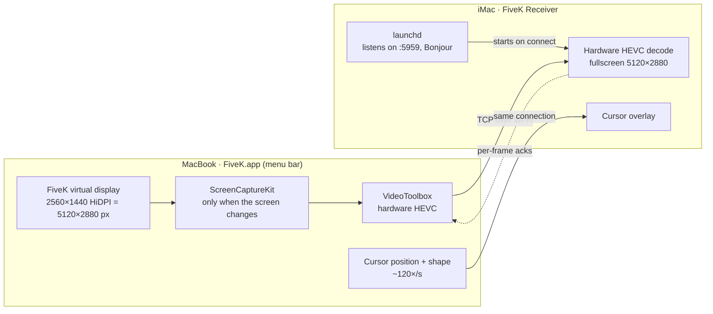

<p align="center"></p>

<h1 align="center">FiveK</h1>

<p align="center">
<b>Use a 27" 5K iMac as a true 5120×2880 extended display for your MacBook, over Wi-Fi.</b><br>
One click to start. Nothing running on either Mac when you're not using it.
</p>

<p align="center">
<a href="https://github.com/ShivamHimatsingka/FiveK/releases/latest"></a>


<a href="LICENSE"></a>
</p>

---

macOS can extend your screen onto another Mac with AirPlay, but AirPlay limits the stream to about **1080p**.
On a 5K iMac that looks blurry, and there's no setting to raise it. Sidecar and Target Display Mode don't help
either: neither supports a 2020 iMac as a display for another Mac.

FiveK streams the picture itself: hardware HEVC encoding on the MacBook, hardware decoding on the iMac, at the
full 5120×2880. Text is as crisp as the iMac's own display.

|  | AirPlay "Extend" | **FiveK** |
|---|---|---|
| Resolution on a 5K iMac | ~1920×1080, upscaled | **5120×2880** (2560×1440 HiDPI) |
| Cursor | part of the video | **drawn on the iMac** (moves at network speed) |
| Starts with | Control Center | one click, from the app or Dock |
| Cost | free | free, no third-party streaming apps |

## Real-world performance

Measured on a **MacBook Air M5** streaming to a **2020 27" iMac** over home Wi-Fi:

| | |
|---|---|
| Frame rate while working | **30 fps** typical, up to **50 fps** when dragging windows |
| Encode on the MacBook | 20–50 ms per 5K frame (hardware HEVC) |
| Network round trip | 8 ms median, 12 ms at the 90th percentile |
| Bandwidth | 2–9 Mbps while working, close to 0 when the screen is still |
| Dropped frames | effectively none (at most 2/s) |

The screen is only captured when something changes, so a still desktop costs almost nothing. At 5K, the
MacBook's video encoder is the limit, not Wi-Fi. **Turn off Low Power Mode** while streaming: with it on, the
frame rate above drops by more than half.

## Quick start

Nothing else to install: FiveK creates its own virtual 5K display.

1. **Download** `FiveK.zip` and `FiveK-Receiver.zip` from the
   **[latest release](https://github.com/ShivamHimatsingka/FiveK/releases/latest)**.
2. **On the iMac:** unzip `FiveK-Receiver.zip`, then **right-click > Open** on **FiveK Receiver**. It
   installs itself and quits. Nothing stays running.
3. **On the MacBook:** unzip `FiveK.zip`, move **FiveK** to Applications, and **right-click > Open** it.
   Allow **Screen Recording** and **Local Network** when asked, then open FiveK again.

From then on, just **open FiveK**. It finds the iMac, adds a 5K display called **FiveK** to your Mac, wakes
the iMac's display and starts streaming. To choose which side of your MacBook the iMac sits on, drag the
FiveK display in **System Settings > Displays > Arrange** while streaming. macOS remembers the position.

> The apps aren't notarized by Apple, which is why the first launch needs **right-click > Open**. If macOS
> keeps denying Screen Recording, build FiveK yourself (below): a self-built copy is signed with your own
> local certificate, which macOS remembers.

## Using it

| To… | Do this |
|---|---|
| **Start** | Open FiveK (from the Dock, Spotlight or Launchpad) |
| **Stop from the MacBook** | Click FiveK again, or use the menu bar icon > **Stop** |
| **Stop from the iMac** | Press **Esc** or **⌘Q**. Or move the iMac's mouse and click **Disconnect** |
| **See live stats** | Click the menu bar icon (fps, Mbps, encode and network times) |

When a session ends, the FiveK display is removed, so your windows come back to the MacBook.

**iMac tips:** keep it logged in, and stop it from sleeping on its own (System Preferences > Energy Saver >
*Prevent computer from sleeping automatically when the display is off*). The display itself can sleep, since
FiveK wakes it.

## How it works



- **Its own virtual display.** FiveK creates the 5K display itself, with CoreGraphics' `CGVirtualDisplay`
  (the private API that display utilities such as BetterDisplay are built on). The display exists only while
  FiveK runs, and only after the iMac has connected, so windows never land on a screen you can't see.
- **Nothing runs when idle.** On the iMac, launchd holds the port and advertises it over Bonjour, and only
  starts the receiver when the MacBook connects. On the MacBook, FiveK runs only while you're streaming.
- **Latency can't build up.** The iMac acknowledges every frame, and the MacBook limits how much unacknowledged
  data is in flight (2–5 frames, capped by bytes). When the link is busy, frames are skipped *before* encoding,
  and the newest frame is always sent once there's room. So the picture is never stale.
- **Responsive cursor.** The pointer isn't part of the video. Its position and shape travel separately and
  are drawn on the iMac, so the pointer moves without waiting for encoding.
- **Sharp when still.** Once the screen stops changing, the last frame is re-encoded a few times so the
  encoder can refine it to full detail.
- **Light on the laptop.** Zero-copy NV12 capture straight into the hardware encoder; no CPU pixel work.

<details>
<summary><b>Wire format</b></summary>

Every message is `[type u8][length u32 big-endian][payload]`.

| Type | Direction | Payload |
|---|---|---|
| 1 | MacBook → iMac | HEVC parameter sets, sent before every keyframe: `[count u8]` then `[len u16][bytes]` each |
| 2 | MacBook → iMac | Frame: `[flags u8, 1 = keyframe]` + 4-byte length-prefixed NAL units |
| 3 | MacBook → iMac | Cursor position: `[x u16][y u16]` as a fraction of the screen × 65535, `[visible u8]` |
| 4 | MacBook → iMac | Cursor image: `[hotX][hotY][width][height]` as u16 in 1/100 pt, then PNG |

Back-channel, iMac → MacBook, one byte each: `0x01` acknowledges a frame; `0x4B` (`K`) requests a keyframe.
</details>

## Building from source

Requires the Xcode command-line tools (`xcode-select --install`). No other dependencies.

```bash
git clone https://github.com/ShivamHimatsingka/FiveK.git
cd FiveK
./make-signing-cert.sh    # once: local code-signing certificate, so macOS remembers Screen Recording
./build.sh --install      # builds everything into build/ and installs /Applications/FiveK.app
```

`build/` then contains `FiveK.app`, `FiveK Receiver.app` (universal: Intel and Apple Silicon) and zips of both.
Copy the receiver to the iMac and open it once, as in Quick start.

## Settings

All optional, on the MacBook:

```bash
defaults write com.fivek.sender Resolution "2560x1440"             # "looks like" size on the iMac
defaults write com.fivek.sender HiDPI -bool true                   # false = 5120×2880 at 1x (tiny text)
defaults write com.fivek.sender Mbps -int 100                      # lower if Wi-Fi stutters
defaults write com.fivek.sender FPS -int 60                        # 30 halves the bandwidth
defaults write com.fivek.sender Host "192.168.1.20"                # skip Bonjour, connect to this IP
defaults write com.fivek.sender LowLatencyRC -bool true            # alternative encoder mode (slower at 5K)
```

Undo any setting with `defaults delete com.fivek.sender <Name>`.

## Troubleshooting

| Problem | Fix |
|---|---|
| **Choppy, or lags when dragging windows** | Turn off **Low Power Mode** (System Settings > Battery). The stats line (`fps · Mbps · enc ms · net ms · skipped`) shows whether encoding or the network is slow. `tools/encbench.swift` benchmarks the encoder on its own. |
| **"Couldn't find the iMac"** | The iMac must be on, logged in and on the same network. Check with `dns-sd -B _fivek._tcp` on the MacBook, or set `Host` (see Settings). |
| **Screen Recording keeps being denied** | Run `./make-signing-cert.sh`, rebuild, then remove FiveK from *Privacy & Security > Screen & System Audio Recording* and add it again. |
| **"Couldn't create the virtual 5K display"** | FiveK relies on a private macOS API (`CGVirtualDisplay`, available since macOS 11). If a future macOS update breaks it, please open an issue. |
| **iMac is on the wrong side** | While streaming, drag the **FiveK** display in System Settings > Displays > Arrange. |
| **Uninstall the receiver** | Open `~/Applications/FiveK Receiver.app` on the iMac and choose **Uninstall**. |

**Logs:** `~/Library/Logs/FiveK.log` on the MacBook, `/tmp/fivek-recv.log` on the iMac.

**Running by hand:** uninstall the receiver, then run `"FiveK Receiver.app/Contents/MacOS/fivek-recv" --listen`
on the iMac. On the MacBook, run `build/fivek-send --host <iMac IP>` (it creates the virtual display too).

## Project layout

```
src/Sender.swift            capture → encode → network, flow control, cursor, refinement
src/FiveKApp.swift          menu bar app: permissions, start/stop, settings
src/VirtualDisplay.swift    creates the 5K virtual display (CGVirtualDisplay)
src/CGVirtualDisplay.h      declarations for the private CGVirtualDisplay classes
src/fivek-recv.swift        receiver: self-installer, launchd socket activation, decode, display
src/send-cli.swift          debug command-line sender
src/make-icon.swift         draws the app icon
build.sh                    builds both apps (+ zips) into build/
make-signing-cert.sh        creates the local "FiveK Local Signing" certificate
tools/encbench.swift        HEVC encoder benchmark (5K/4K, each rate-control mode)
tools/airplay-native.swift  lists or sets display modes with CoreGraphics (diagnostics)
```

## Roadmap

- [ ] Give the encoder fewer frames at once, to cut latency during fast motion
- [ ] UDP transport with loss recovery, for congested Wi-Fi
- [ ] Automatic 30 fps fallback under load
- [ ] Notarized builds, so the first launch doesn't need right-click > Open

## License

[MIT](LICENSE) © 2026 Shivam Himatsingka
